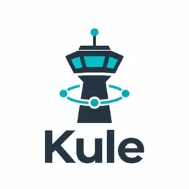

<div align="center">



# Kule

**Securely manage your hosts from any MCP client.**

A self-hosted [Model Context Protocol](https://modelcontextprotocol.io/) server for authenticated, auditable host administration.

[](https://github.com/yesvus/kule/actions/workflows/ci.yml)
[](https://github.com/yesvus/kule/actions/workflows/container.yml)
[](LICENSE)
[](pyproject.toml)

</div>

## Overview

Kule gives MCP-compatible assistants a secure way to inspect and operate approved machines. It combines OAuth/OIDC authentication, group-based authorization, bounded tool execution, and verifiable audit logs in a service you control.

### Features

- **MCP-native:** Connect through an authenticated Streamable HTTP endpoint.
- **Identity-aware:** OAuth/OIDC login and group-based access policies.
- **Controlled execution:** Explicitly enabled host operations, with time and output limits.
- **Auditable:** Structured events and verifiable hash chains. Redaction is best-effort; protect audit files against unauthorized writes.
- **Emergency stop:** Disable tool calls using a server-side kill-switch file.

## Getting started

**Requirements:** Python 3.11+, an OIDC identity provider, and HTTPS termination for the public endpoint.

```bash
git clone https://github.com/yesvus/kule.git
cd kule
python -m pip install .
kule init --config config.toml
```

The initializer prompts for the public HTTPS origin, OIDC discovery URL, and registered client ID; it writes a private configuration with host execution disabled. For scripted setup, pass `--public-url`, `--oidc-config-url`, and `--client-id` instead. See the [first-run guide](docs/ONBOARDING.md) and [configuration reference](docs/CONFIGURATION.md). Supply credentials via your environment or secret manager:

```bash
export KULE_OIDC_CLIENT_SECRET="your-oidc-client-secret"
export KULE_JWT_SIGNING_KEY="$(python -c 'import secrets; print(secrets.token_urlsafe(48))')"

kule doctor --config config.toml
kule serve --config config.toml
```

Generate the signing key once, store it in your secret manager, and reuse the same value across restarts. Rotating it invalidates existing OAuth state. Connect your MCP client to `https://your-domain.example/mcp`. Keep host execution disabled until its access policy and SSH identity are configured.

For local development:

```bash
python -m pip install -e '.[dev]'
ruff check .
ruff format --check .
pytest -q
```

## Architecture

Kule is being developed as three components in one repository:

| Component | Responsibility |
| --- | --- |
| **Hub** | MCP endpoint, OAuth/OIDC, host inventory, policy, routing, and audit |
| **Agent** | Local host operations and agent-enforced execution policy |
| **Protocol** | Versioned, authenticated communication between Hub and Agent |

**Development status:** The current server supports authorized operations on a configured host. Multi-host enrollment and the dedicated Hub–Agent transport are under development. The `hub/`, `agent/`, and `protocol/` directories currently contain architecture documentation.

See [Architecture](docs/architecture/host-control-monorepo.md) for the technical design.

## Community

Contributions and bug reports are welcome. Read [Contributing](CONTRIBUTING.md) before opening a pull request. To report a vulnerability, see [Security](SECURITY.md).

Licensed under the [Apache License 2.0](LICENSE).
